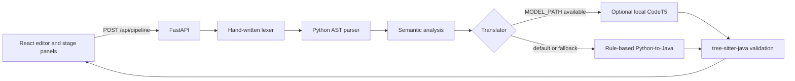

# CodeLens Translator

CodeLens Translator is a compiler-design teaching app. It accepts a small,
documented subset of Python and makes the steps toward Java, C++, or C visible:
tokens, an expandable syntax tree, inferred symbols and diagnostics, generated
source, and a syntax check for the selected target.

The app has a React + Vite frontend and a FastAPI backend. Rule-based
translation works without a model or GPU. A fine-tuned CodeT5 model is an
optional add-on.

## Requirements

- Python 3.10 or newer
- Node.js 22 LTS (for the Vite 8 development server)

## Install and run

Open two PowerShell windows in the `codelens` project folder.

### 1. Start the backend

```powershell
py -3 -m venv .venv
.\.venv\Scripts\Activate.ps1
python -m pip install -r backend\requirements.txt
python -m uvicorn app.main:app --reload --app-dir backend
```

If script activation is disabled, use the environment's Python directly:

```powershell
.\.venv\Scripts\python.exe -m pip install -r backend\requirements.txt
.\.venv\Scripts\python.exe -m uvicorn app.main:app --reload --app-dir backend
```

The API is at <http://127.0.0.1:8000/> and its interactive docs are at
<http://127.0.0.1:8000/docs>.

### 2. Start the frontend

In the second PowerShell window, from the same `codelens` folder:

```powershell
Set-Location frontend
npm install
npm run dev
```

Open the local Vite address shown in the terminal (usually
<http://localhost:5173/>). Vite forwards `/api` requests to the backend on
port 8000. Start the backend before translating.

## Use the application

1. Enter a Python program or select one of the 17 examples in the Python editor.
2. Choose **Translate**. Edit the generated Java in the adjacent editor if needed.
3. Select a pipeline stage to inspect its results. Source diagnostics link back
   to the affected editor line. The AST panel can switch
   between an expandable tree and raw JSON. In Semantic analysis, select a
   Python line or AST graph node to inspect its syntax tree, inferred symbols,
   and mapped generated-code lines. Use **Download PNG** to save the graphical
   tree as an image. Generated mappings are approximate when compiler
   scaffolding is involved.
4. Choose Java, C++, or C as the output language. Java can be compiled and
   executed locally; optional program input is sent to both Python and Java so
   their output can be compared.

The supported-feature matrix is visible above the pipeline and marks each
construct as supported, partial, or unsupported for all three targets. Partial
entries state the important subset limits. Unsupported constructs fail with a
line-specific translation diagnostic rather than being silently omitted.

**Local execution warning:** `/api/execute` runs both submitted Python and Java
programs as child processes. It is restricted to loopback clients, with source,
input, output, compilation, and execution limits, but it is not an OS sandbox.
Do not run untrusted programs or expose this app/API to a network.

The frontend sends one request to `POST /api/pipeline` with `code` and an
optional `target` (`java`, `cpp`, or `c`; defaults to `java`). That endpoint
returns each stage's status, result, and error independently. If a stage fails,
earlier results remain visible and later stages are marked skipped.

## Compiler stages and API

| Endpoint | Input | Output |
| --- | --- | --- |
| `POST /api/lex` | `{"code":"..."}` | Tokens with type, value, line, and column |
| `POST /api/parse` | `{"code":"..."}` | Nested AST JSON |
| `POST /api/semantic` | `{"code":"..."}` | Symbols, warnings, and errors |
| `POST /api/translate` | `{"code":"...", "target":"cpp"}` | Generated source (`code`), target, method, optional fallback reason |
| `POST /api/validate` | `{"java_code":"..."}` | Java syntax status, errors, confidence |
| `POST /api/execute` | `{"python_code":"...", "java_code":"...", "stdin":""}` | Java compile status, Python/Java output, and comparison |
| `POST /api/pipeline` | `{"code":"...", "target":"c"}` | The five stages with independent status/result/error fields |
| `GET /api/samples` | — | Sample Python source and expected Java excerpts |

`GET /health` returns `{"status":"ok"}`. Invalid requests to a single-stage
endpoint return HTTP 422 with a readable detail message.

For compatibility, Java translation responses continue to include `java_code`;
other targets return generated source in `code`. Pipeline validation uses the
matching Java, C++, or C grammar.

## Supported Python subset

Version 1 supports:

- Assignments and inferred `int`, `float`, `str`, and `bool` types
- Arithmetic, comparison, and logical operators, including string repetition
  by an integer
- `if` / `elif` / `else`, `for ... in range(...)`, and `while`
- Iteration over string characters, list items, and dictionary `.items()` pairs
- Top-level function definitions, positional parameters (including trailing
  default values), calls, two-item tuple returns, and tuple unpacking
- Simple top-level classes with `self` fields, `__init__`, instance methods,
  instance creation, and method calls (no inheritance); named parameter
  annotations are accepted
- The `if __name__ == "__main__":` entry-point guard
- `print()`, `input()`, `int()` / `float()` / `str()` conversions, list literals,
  indexing, and one-value `append()`
- Common string methods: `upper`, `lower`, `strip`, `split`, `join`, `replace`,
  `startswith`, `endswith`, and `find` (within the translator's supported
  argument forms)
- Positive-step string/list slices and dictionaries with string/integer keys,
- indexing, assignment, `get()`, membership, `.items()`, and `len()`
- One unfiltered list-comprehension generator; `sum()` and dictionary-item
  sorting with `sorted(items, key=lambda item: item[1], reverse=...)`
- Basic f-strings, including fixed-point formats such as `{value:.2f}`
- `try` / `except Exception as name` (without `else` or `finally`)
- `print(..., end="...")` for a string-literal ending

`input()` produces a string, matching Python. Convert numeric input explicitly
before using it in `range()`, for example `rows = int(input("Rows: "))`.

Dictionary unpacking, slice assignment, negative slice bounds, slice steps
other than 1, filtered or multiple-generator comprehensions, arbitrary
`sorted()` keys, multiple exception handlers, `except` types other than
`Exception`, return annotations, complex parameter annotations, decorators,
nested functions, other f-string format specifications, and loop `else`
clauses are not supported. Unsupported syntax is reported with a source line
rather than being silently ignored. Press Tab in the source editor to insert four spaces. Semantic
analysis reports undefined names and type-changing assignments. Java
validation checks syntax; it does not prove that Java and Python have identical
runtime behavior. C and C++ generation also supports numeric list literals and
parameters, indexed reads and writes, string-character iteration, string
indexing and concatenation, and two-item tuple returns/unpacking. C represents
numeric lists with a pointer-and-length struct; C++ uses `std::vector<int>`.
Classes, dictionaries, list comprehensions, f-strings, and default or
variadic function arguments remain unsupported by the C and C++ translators.
The pipeline response includes generated-to-Python `source_map` entries for all
three targets; these identify related lines rather than a character-accurate
mapping, and generated scaffolding can share a source line.

## Architecture



- `backend/app/lexer.py` scans source characters and emits tokens, indentation
  transitions, and source positions.
- `backend/app/parser.py` uses Python's built-in `ast` module and converts nodes
  into a small, readable JSON tree.
- `backend/app/semantic.py` tracks global/function scopes and infers simple
  types for the symbol table.
- `backend/app/translator.py` generates a Java class with a `main` method and
  static functions. It uses the optional ML model only when configured and
  loadable; otherwise it reports the fallback and uses rules.
- `backend/app/validator.py` parses the Java output with tree-sitter-java.
- `backend/app/execution.py` compiles and runs locally generated/edited Java and
  the Python reference in temporary directories, then compares normalized
  stdout. It limits input/output sizes and process run time; this is not a
  security sandbox.

## Tests and checks

From the `codelens` folder:

```powershell
$env:PYTHONPATH = "backend"
.\.venv\Scripts\python.exe -m pytest backend\tests -q
```

Frontend production build and lint:

```powershell
Set-Location frontend
npm run build
npm run lint
```

The backend test suite covers tokens and indentation, supported and unsupported
AST forms, type inference, Java output, syntax validation, all 17 samples, and
the API pipeline's partial-result behavior. It also translates and compiles the
20 standard algorithm examples in all three targets, then runs representative
array, string, tuple, and control-flow cases against the generated programs.

## Optional ML fine-tuning

ML dependencies are kept separate so the normal app install stays lightweight.
See [ml/README.md](./ml/README.md) for dataset preparation, GPU fine-tuning, and
how to configure `MODEL_PATH`. Training examples are JSONL pairs with
`python_code` and complete `java_code` fields. The prepared model input
serializes the lexer tokens and AST.

When model output is used, confidence is the average probability of its
generated tokens. When the optional model is missing or cannot be loaded, the
translation response includes a fallback reason and reports
`"method":"rule-based"`.

For rule-based output, the confidence score is the proportion of meaningful
AST constructs handled by the translator. Unsupported syntax is rejected
before translation and therefore does not receive a misleading Java result.

### Hosted Hugging Face translation

To send source code and backend-generated lexer tokens to a hosted
instruction-following model, set these variables in the backend's PowerShell
window before starting or restarting Uvicorn:

```powershell
$env:HF_TOKEN = "hf_your_token"
$env:HF_MODEL = "Qwen/Qwen2.5-Coder-7B-Instruct"
```

`HF_MODEL` is optional; this model is the default. It must be available to
your Hugging Face Inference Providers account. Keep `HF_TOKEN` on the backend
only. The model returns a JSON AST and Java source; the backend's own Python
AST remains available in Syntax analysis, and the model's AST appears with its
Java output. The backend validates the model response and parses the generated
Java. Hosted providers do not supply a comparable confidence score, so the
Validation panel shows confidence as unavailable. If the token is unset or a
hosted request fails, the UI explains why and shows the rule-based fallback.

## Screenshots

For a course report or demo, capture the running app with these views:

- The editor with the sample selector and Translate button
- The token table and expanded AST tree
- The semantic symbol table and diagnostics
- Generated Java beside its validation result and confidence bar

## Project layout

```text
codelens/
  backend/app/       FastAPI routes and compiler stages
  backend/tests/     pytest suite
  frontend/          React + Vite user interface
  ml/                Optional CodeT5 data preparation and training
  samples/           17 Python examples with expected Java excerpts
```
